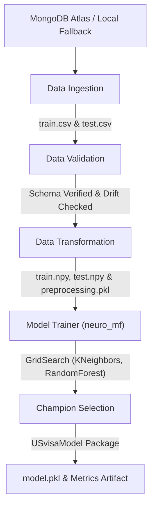

# 🇺🇸 US Visa Approval Prediction System

An end-to-end, production-grade Machine Learning & MLOps system that predicts whether a US visa application will be **Certified** or **Denied** based on applicant attributes, education, employer profile, job requirements, and prevailing wage statistics.

Built with modular Python architecture, automated artifact tracking, data drift monitoring via Evidently AI, declarative model search using `neuro_mf`, cloud-native storage, and scalable deployment pipelines.

---

## 📌 Project Overview

Every year, hundreds of thousands of foreign professionals apply for US work visas (such as H-1B, L-1, EB categories). Evaluating these applications is labor-intensive, time-consuming, and subject to administrative backlogs.

This system automates and streamlines visa classification:
* **Binary Classification Goal:** Predict visa status (`Certified` vs `Denied`).
* **Dataset Characteristics:** 25,480 historical applicant records with 12 socio-economic and employment features.
* **Production MLOps Design:** Modular components (Ingestion, Validation, Transformation, Model Trainer, Evaluator, Pusher) managed via artifact directories, cloud data synchronization, and automated CI/CD.

---

## 🛠️ Tech Stack & Tools

| Category | Technologies |
| :--- | :--- |
| **Language** | Python 3.10 / 3.12 |
| **Model Selection & Tuning** | `neuro_mf`, `scikit-learn` (`GridSearchCV`) |
| **Exploration & Class Balancing** | Jupyter, `imbalanced-learn` (`SMOTEENN`), `xgboost`, `catboost` |
| **Data Processing & Stats** | `pandas`, `numpy`, `scipy` |
| **Data Drift & Monitoring** | `Evidently AI` |
| **Cloud Database** | `MongoDB Atlas` (Cloud NoSQL Feature Store) |
| **Cloud Artifact & Model Registry** | `AWS S3`, `boto3` |
| **Web Framework & API** | `FastAPI`, `Uvicorn`, `Jinja2` Templates |
| **DevOps & Containerization** | `Docker`, `GitHub Actions` CI/CD, `AWS ECR`, `AWS EC2` |

---

## 📂 Project Structure

```text
US-Visa-Approval-Prediction-System/
│
├── .env                              # Environment secrets (MONGODB_URL_KEY, AWS credentials)
├── .gitignore                        # Git exclusion rules
├── Dockerfile                        # Production Docker container definition
├── requirements.txt                  # Python dependencies
├── setup.py                          # Packaging script for local editable install (-e .)
├── demo.py                           # Training pipeline runner & demonstration entrypoint
├── app.py                            # FastAPI application entrypoint (UI & REST API)
│
├── config/                           # Declarative configurations
│   ├── model.yaml                    # Model hyperparameters and GridSearch candidate grids
│   └── schema.yaml                   # Dataset schema, column types, drop columns, and target
│
├── notebook/                         # Research, EDA, & experiment notebooks
│   ├── Visadataset.csv               # Raw historical US visa application dataset
│   ├── EDA_US_visa.ipynb             # Comprehensive exploratory data analysis
│   ├── Feature_engineering_and_model_traning.ipynb  # Preprocessing & classifier benchmarks
│   ├── mongodb_demo.ipynb            # MongoDB Atlas connection & batch upload prototype
│   └── data_drift_demo_with_evidently.ipynb         # Data drift profiling with Evidently AI
│
├── us_visa/                          # Core application package
│   ├── components/                   # Modular pipeline execution components
│   │   ├── __init__.py
│   │   ├── data_ingestion.py         # MongoDB Atlas sync, fallback, & 80:20 train/test split
│   │   ├── data_validation.py        # Schema validation & Evidently data drift analysis
│   │   ├── data_transformation.py    # Feature engineering, ColumnTransformer & SMOTEENN
│   │   ├── model_trainer.py          # neuro_mf GridSearch, model selection & packaging
│   │   ├── model_evaluation.py       # S3 production model comparison & threshold check
│   │   └── model_pusher.py           # Pushes validated model artifacts to AWS S3
│   │
│   ├── configuration/                # Cloud & database clients
│   │   ├── __init__.py
│   │   ├── aws_connection.py         # AWS S3 client management
│   │   └── mongo_db_connection.py    # Resilient MongoDB client with TLS fallback
│   │
│   ├── constants/                    # Project-wide constant definitions
│   │   └── __init__.py               # DB names, file paths, train/test ratios, env keys
│   │
│   ├── data_access/                  # Data access layer
│   │   └── usvisa_data.py            # Converts MongoDB collections to pandas DataFrames
│   │
│   ├── entity/                       # Strongly typed data contracts
│   │   ├── __init__.py
│   │   ├── config_entity.py          # Component configuration dataclasses
│   │   ├── artifact_entity.py        # Component output artifact dataclasses
│   │   └── estimator.py              # USvisaModel wrapper & TargetValueMapping
│   │
│   ├── exception/                    # Custom exception handlers
│   │   └── __init__.py               # Detailed error tracking with file name & line numbers
│   │
│   ├── logger/                       # Timestamped logging utility
│   │   └── __init__.py               # Formatted logging to console and log files
│   │
│   ├── pipline/                      # Execution pipelines
│   │   ├── __init__.py
│   │   ├── training_pipeline.py      # Automated training pipeline orchestrator
│   │   └── prediction_pipeline.py    # Real-time inference & user input mapping
│   │
│   └── utils/                        # Common helper utilities
│       └── main_utils.py             # YAML reading, dill serialization, numpy converters
│
└── artifact/                         # Generated artifacts (ignored by git, created on run)
    └── <timestamp>/
        ├── data_ingestion/
        │   ├── feature_store/usvisa.csv
        │   └── ingested/
        │       ├── train.csv         # 80% split
        │       └── test.csv          # 20% split
        ├── data_validation/
        │   └── drift_report/
        │       └── report.yaml       # Evidently data drift analysis metrics
        ├── data_transformation/
        │   ├── transformed/
        │   │   ├── train.npy         # Resampled train array
        │   │   └── test.npy          # Transformed test array
        │   └── transformed_object/
        │       └── preprocessing.pkl # Fitted ColumnTransformer pipeline
        └── model_trainer/
            └── trained_model/
                └── model.pkl         # Bundled USvisaModel (preprocessor + best estimator)
```

---

## 🚦 Pipeline Roadmap & Implementation Status

- [x] **Project Scaffolding:** Modular directory hierarchy, custom logging, and file/line tracing exception system.
- [x] **EDA & Prototyping:**
  - In-depth Exploratory Data Analysis ([`EDA_US_visa.ipynb`](notebook/EDA_US_visa.ipynb)).
  - Feature engineering, categorical encoding, power transformations, and classifier benchmarking ([`Feature_engineering_and_model_traning.ipynb`](notebook/Feature_engineering_and_model_traning.ipynb)).
  - Data drift analysis prototyping using Evidently AI ([`data_drift_demo_with_evidently.ipynb`](notebook/data_drift_demo_with_evidently.ipynb)).
- [x] **Data Ingestion Component:**
  - Automated cloud connection to MongoDB Atlas database `US_VISA`, collection `visa_data`.
  - Resilient hybrid fallback mechanism: automatically falls back to local `notebook/Visadataset.csv` if port 27017 is blocked by ISP middleboxes or offline.
  - Automatically exports raw data to `feature_store/usvisa.csv` and partitions into `train.csv` (80%) and `test.csv` (20%) under timestamped artifact folders.
- [x] **Data Validation Component:**
  - Validates total column count, column names, and numeric/categorical data types against `config/schema.yaml`.
  - Evaluates dataset drift between train and test splits using Evidently AI and writes comprehensive YAML drift reports.
- [x] **Data Transformation Component:**
  - Automated feature engineering: derives `company_age = CURRENT_YEAR - yr_of_estab` and drops non-predictive columns (`case_id`, `yr_of_estab`).
  - Implements multi-stage preprocessing via `ColumnTransformer` (`OneHotEncoder`, `StandardScaler`, `OrdinalEncoder`, `PowerTransformer`).
  - Addresses target class imbalance using **SMOTEENN** (combined oversampling and edited nearest-neighbors undersampling).
  - Serializes fitted preprocessor to `preprocessing.pkl` and transformed datasets to `train.npy` and `test.npy`.
- [x] **Model Training & Tuning (`neuro_mf`):**
  - Fully declarative configuration in `config/model.yaml` defining models (`KNeighborsClassifier`, `RandomForestClassifier`) and hyperparameter grids.
  - Automated Grid Search with 3-fold cross-validation orchestrated via `neuro_mf.ModelFactory`.
  - Automated champion selection based on expected accuracy threshold (`expected_accuracy: 0.6`).
  - Bundles the fitted preprocessor and trained estimator into a unified `USvisaModel` object saved to `model.pkl`.
  - Computes test evaluation metrics (`F1 Score`, `Precision`, `Recall`).
- [ ] **Model Evaluation & Production Pusher:** AWS S3 production model challenger-champion comparison and automated registry update.
- [ ] **Web Application & Deployment:** FastAPI web interface, Dockerization, and AWS ECR/EC2 CI/CD automation via GitHub Actions.

---

## 🚀 Getting Started

### 1. Clone the Repository

```bash
git clone https://github.com/<your-username>/US-Visa-Approval-Prediction-System.git
cd US-Visa-Approval-Prediction-System
```

### 2. Environment Setup

It is recommended to use Python **3.10** or **3.12** inside a virtual environment:

```bash
# Using Python venv
python -m venv .venv
.\.venv\Scripts\Activate.ps1   # On Windows
# source .venv/bin/activate    # On Linux/macOS

# Install dependencies and local package in editable mode
pip install -r requirements.txt
pip install -e .
```

### 3. Environment Variables Configuration

Create a `.env` file in the project root:

```env
# MongoDB Atlas Connection
MONGODB_URL_KEY="mongodb+srv://<username>:<password>@usvisaproject.xxxxxx.mongodb.net/?retryWrites=true&w=majority&appName=USVisaProject"

# AWS Configuration (for Model Evaluation & S3 Model Pusher)
AWS_ACCESS_KEY_ID="your_aws_access_key"
AWS_SECRET_ACCESS_KEY="your_aws_secret_key"
AWS_DEFAULT_REGION="us-east-1"
```

> [!NOTE]
> The environment variable key is **`MONGODB_URL_KEY`** (defined in `us_visa/constants/__init__.py`). Ensure your MongoDB Atlas user has read/write privileges and Network Access has your IP (or `0.0.0.0/0`) whitelisted.

---

## 🏃 Running the Pipeline

### Execute Full Training Pipeline

To run the automated training pipeline across all implemented components:

```bash
python demo.py
```

### Pipeline Execution Flow & Artifact Outputs

When `demo.py` is executed, `TrainPipeline` orchestrates the following stages sequentially:



1. **Data Ingestion:**
   - Fetches dataset from MongoDB Atlas.
   - Saves `artifact/<timestamp>/data_ingestion/feature_store/usvisa.csv`.
   - Generates 80:20 split: `train.csv` and `test.csv`.

2. **Data Validation:**
   - Verifies schema against `config/schema.yaml`.
   - Evaluates statistical drift using Evidently AI.
   - Saves `artifact/<timestamp>/data_validation/drift_report/report.yaml`.

3. **Data Transformation:**
   - Engineers `company_age` and drops unwanted columns.
   - Encodes and transforms features via `ColumnTransformer`.
   - Balances minority class on training data with `SMOTEENN`.
   - Saves `train.npy`, `test.npy`, and `preprocessing.pkl`.

4. **Model Trainer (`neuro_mf`):**
   - Parses `config/model.yaml` and initializes candidate classifiers.
   - Runs cross-validated grid search across hyperparameter combinations.
   - Validates that the best model exceeds the expected accuracy threshold (`>= 0.6`).
   - Packages the preprocessor and trained estimator into `USvisaModel`.
   - Saves deployable pipeline artifact to `artifact/<timestamp>/model_trainer/trained_model/model.pkl`.

Execution logs are streamed to the console and saved under timestamped files in the `logs/` directory.

---

## ⚙️ Declarative Model Configuration (`config/model.yaml`)

Candidate models and their tuning hyperparameter search spaces are fully decoupled from the code:

```yaml
grid_search:
  class: GridSearchCV
  module: sklearn.model_selection
  params:
    cv: 3
    verbose: 3

model_selection:
  module_0:
    class: KNeighborsClassifier
    module: sklearn.neighbors
    params:
      algorithm: kd_tree
      weights: uniform
      n_neighbors: 3
    search_param_grid:
      algorithm: [auto, ball_tree, kd_tree, brute]
      weights: [uniform, distance]
      n_neighbors: [3, 5, 9]

  module_1:
    class: RandomForestClassifier
    module: sklearn.ensemble
    params:
      max_depth: 10
      max_features: sqrt
      n_estimators: 3
    search_param_grid:
      max_depth: [10, 15, 20]
      max_features: [sqrt, log2]
      n_estimators: [3, 5, 9]
```

---

## 💡 Troubleshooting & FAQs

### MongoDB TLS Alert 80 (`tlsv1 alert internal error`)
Certain Indian ISPs (e.g., GTPL Hathway, ACT, Excitel) run deep packet inspection (DPI) on non-HTTP TLS traffic on port 27017, triggering an OpenSSL `TLSV1_ALERT_INTERNAL_ERROR`.
* **Built-in Workaround:** `DataIngestion` automatically detects connection drops and seamlessly falls back to `notebook/Visadataset.csv`, allowing pipeline development to continue unblocked.
* **Direct Cloud Fix:** Connect via a mobile hotspot (Jio / Airtel) or activate Cloudflare WARP (1.1.1.1) to bypass local ISP port filtering.

### Scikit-Learn Pipeline Serialization
The final saved model in `model.pkl` is an instance of `USvisaModel`, which encapsulates both the fitted `preprocessing_object` and `trained_model_object`. Raw production records can be passed directly to `model.predict(dataframe)` once feature-engineered.

---

## 📜 License

Distributed under the [MIT License](LICENSE).
